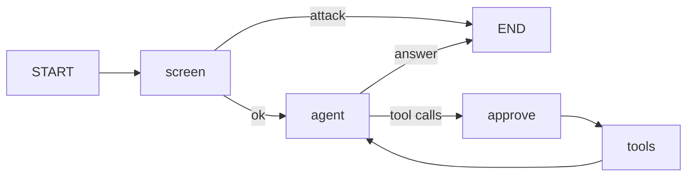

# Spec 002: LangGraph agent

Status: **accepted** · Tickets: T-005, T-007

## Problem
The demo shows one framework (OpenAI Agents SDK) and one framework-free loop. To prove that MCP
decouples tools from the framework, the same tools and defences should also run in a second,
graph-based framework.

## Solution
`src/graphAgent.ts`: a LangGraph.js `StateGraph`.
- **Tools**: loaded from the *same* `src/server.ts` over stdio with `@langchain/mcp-adapters`.
- **Model**: `@langchain/openai` `ChatOpenAI`, pointed at the configured provider (Ollama by
  default) through `src/llm.ts`.
- **Memory**: a `MemorySaver` checkpointer, one `thread_id` per conversation.

| Layer | Node / place | How |
| --- | --- | --- |
| 1 Input guardrail | `screen` | Structured-output classifier; on error it **fails closed** |
| 2 Tool-output guardrail | `tools` | The same `INJECTION` regex as the SDK agent; result withheld |
| 3 Human approval | `approve` | LangGraph `interrupt()`: the graph pauses and is resumed with `Command({ resume })` |
| 4 Server rule | `server.ts` | Unchanged |

`approve` has no side effects, because LangGraph re-runs an interrupted node from the start on
resume. If tools ran in the same node, a resume could run them twice.

## Acceptance criteria
1. The graph uses the MCP server's three tools; there are no local tool definitions.
2. Jailbreak → `blocked`, and the model is never called.
3. Injection in `search_kb` output → withheld before the model sees it.
4. `issue_refund` pauses the graph; a rejection gives "A human rejected this refund." and the
   tool is not called.
5. Approved 300 EUR → the server refuses (layer 4).
6. `tests/testGraph.ts` proves 2–5 with a scripted model and no LLM.

## Out of scope
LangGraph Platform/Studio, persistent checkpointers.
